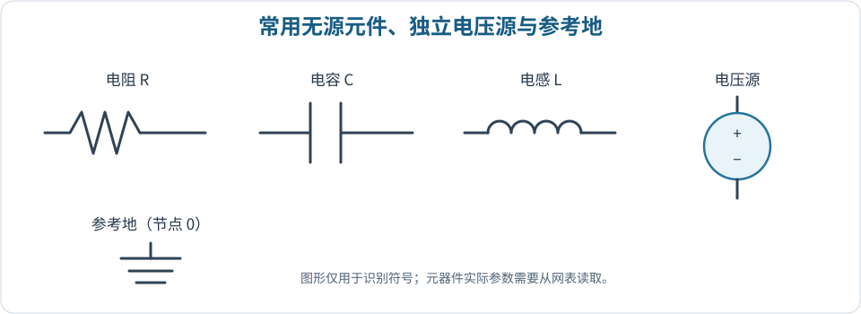
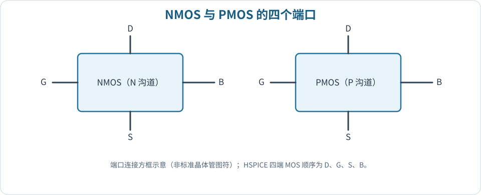

# MOS 晶体管的基础与工作状态

## 四个端口及电压定义

MOS 晶体管通常包含漏极 D、栅极 G、源极 S、衬底 B（体端）。对于 NMOS，常按下列电压定义： 

$$
V_{\mathrm{GS}}=V_G-V_S,\qquad V_{\mathrm{DS}}=V_D-V_S,\qquad V_{\mathrm{SB}}=V_S-V_B.
$$

 **源极是分析时的电位参考端，不能把“某节点电压”和“栅源电压”混为一谈。**若源极处于 $0.8\,\mathrm V$，栅极对地 $1.4\,\mathrm V$，则 $V_{GS}=0.6\,\mathrm V$，而不是 $1.4\,\mathrm V$。

PMOS 通常使用正值的 $V_{SG}=V_S-V_G$、$V_{SD}=V_S-V_D$ 和 $|V_{TP}|$ 来描述；这比直接代入负的 PMOS 阈值电压更便于记忆。NMOS 的衬底常接电路最低电位，PMOS 的阱（体端）常接最高电位，以防止源／漏—体 pn 结意外正向偏置。

## NMOS 的三个主要工作区域

定义 $V_{OV}=V_{\mathrm{GS}}-V_{\mathrm{TH}}$，它称为**过驱动电压**。在 $V_{\mathrm{DS}}\ge 0$、无明显亚阈值导电且采用长沟道平方律近似时：

| **区域**       | **判断条件**                                                    | **主要特征**                                         |
|:---------------|:----------------------------------------------------------------|:-----------------------------------------------------|
| 截止区         | $V_{\mathrm{GS}}\le V_{\mathrm{TH}}$                             | 理想模型中 $I_D\simeq0$；实际存在漏电流。            |
| 线性／三极管区 | $V_{\mathrm{GS}}>V_{\mathrm{TH}}$, $0\le V_{\mathrm{DS}}<V_{OV}$ | 沟道贯通，$I_D$ 随 $V_{DS}$ 增加。                   |
| 饱和区         | $V_{\mathrm{GS}}>V_{\mathrm{TH}}$, $V_{\mathrm{DS}}\ge V_{OV}$  | 漏端沟道夹断；理想长沟道电流近似不随 $V_{DS}$ 变化。 |

$$
\begin{aligned}
I_{D,\mathrm{lin}}&\approx \mu_n C_{ox}\frac{W}{L}\left[(V_{\mathrm{GS}}-V_{\mathrm{TH}})V_{\mathrm{DS}}-\frac{V_{\mathrm{DS}}^2}{2}\right],\\
I_{D,\mathrm{sat}}&\approx\frac12\mu_n C_{ox}\frac{W}{L}(V_{\mathrm{GS}}-V_{\mathrm{TH}})^2.
\end{aligned}
$$

 $\mu_n$ 为电子迁移率，$C_{ox}$ 为单位面积栅氧化层电容，$W$ 和 $L$ 分别为沟道宽度与长度。以上是**理解趋势与完成基础计算**的公式，不应当替代深亚微米工艺模型的精确仿真。

> 饱和不等于完全无电流变化。受沟道长度调制、速度饱和等影响，实测 $I_D-V_{DS}$ 的“饱和段”往往仍有一定正斜率。**栅极控制电流、漏极改变电流分布、体端影响阈值电压**是解释实验曲线的主线。

## 如何阅读两类伏安特性曲线

*（示意图参阅原讲义 PDF；此处保留理论说明。）*

当横轴为 $V_{DS}$、每条曲线对应不同 $V_{GS}$ 时，得到**输出特性族**；横轴为 $V_{GS}$、每条曲线对应不同 $V_{DS}$ 时，得到**转移特性族**。实验一要求通过调整 `.dc` 的扫描次序，将前者改为后者。

> **题型：根据电压判断工作区域。**某 NMOS 的 $V_G=1.2\,\mathrm V$、$V_S=0.2\,\mathrm V$、$V_D=0.8\,\mathrm V$，设 $V_{TH}=0.4\,\mathrm V$。则 $V_{GS}=1.0\,\mathrm V$、$V_{DS}=0.6\,\mathrm V$、$V_{OV}=0.6\,\mathrm V$，处于理想模型的饱和边界。若只依据 $V_G=1.2\,\mathrm V$ 判断，会忽视源极抬升。

## PMOS 的判别与电流方向

PMOS 在 $V_{SG}>|V_{TP}|$ 时形成导电沟道；长沟道饱和判据为 $V_{SD}\ge V_{SG}-|V_{TP}|$。在输出特性图上，若坐标使用 $V_{DS}=V_D-V_S$ 与从漏到源定义的有符号 $I_D$，PMOS 常位于负电压、负电流象限；若改用 $V_{SD}$ 与 $|I_D|$，曲线可在第一象限表示。**必须先确认坐标和电流正方向，不能只凭正负判定结果错误。**（资料对应：实验二。）

## 短沟道效应的基本认识

深亚微米工艺中，器件电流特性会偏离平方律。应能解释：**速度饱和**会使高电场下电流对栅压的依赖减弱；**沟道长度调制**使饱和区电流随漏压上升；**体效应**使体源反向偏置增大时阈值升高。由于这些效应共同存在，手算结果与 HSPICE 工艺模型的曲线不完全一致是正常的，但需要先排除节点、单位与偏置设置错误。

## 元器件与 MOS 端口示意

下图展示常见元器件和 MOS 四端连接。四端连接方框用于阐释端口名称，不代表完整的标准 MOS 图符；判读具体电路时应以模型端口定义为准。

*图 2-1　常见元器件和参考地。*

*图 2-2　MOS 器件漏极 D、栅极 G、源极 S 与体端 B。*
