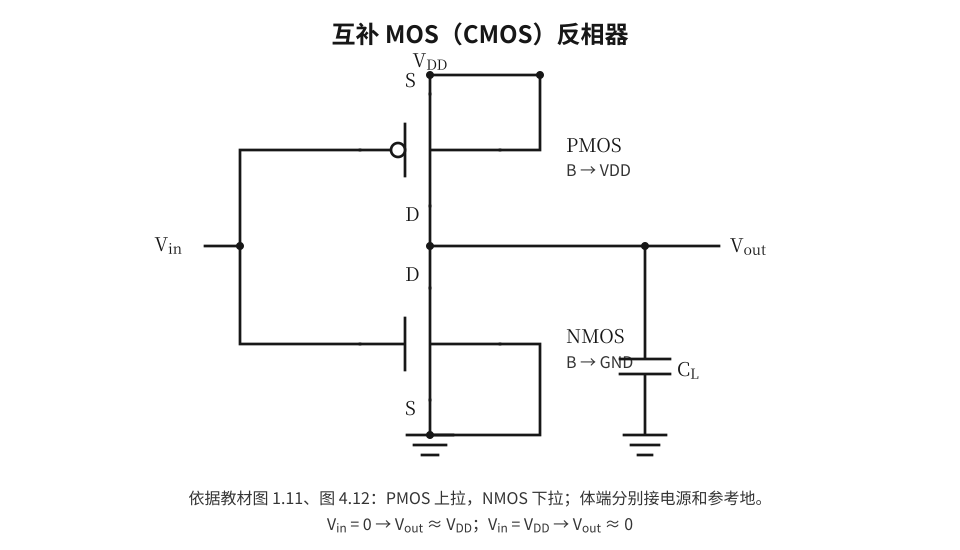

# 反相器、负载线与噪声容限

## 电阻负载 NMOS 反相器

一个典型电阻负载反相器由上拉电阻 $R_L$ 和下拉 NMOS 组成。输入低时 NMOS 关闭，输出近似 $V_{OH}\approx V_{\mathrm{DD}}$；输入高时 NMOS 导通，输出取决于晶体管电流和电阻电流平衡： 

$$
I_D(V_{GS}=V_{in},V_{DS}=V_{out})=I_R=\frac{V_{\mathrm{DD}}-V_{out}}{R_L}.
$$

 在 $I_D-V_{DS}$ 图中，电阻负载线为从 $(0,V_{\mathrm{DD}}/R_L)$ 到 $(V_{\mathrm{DD}},0)$ 的直线。给定 $V_{in}$ 后，晶体管输出特性与负载线的交点确定 $V_{out}$，依次改变 $V_{in}$ 即得电压传输特性（VTC）。（资料对应：实验五；教材第 4 章。）

*（示意图参阅原讲义 PDF；此处保留理论说明。）*

在输出低电平时，电阻负载反相器通常存在直流通路 $V_{\mathrm{DD}}\to R_L\to\mathrm{NMOS}\to0$，因此静态功耗**不为零**。例如 $R_L=30\,\mathrm{k}\Omega$、$V_{\mathrm{DD}}=1.2\,\mathrm V$、$V_{OL}=0.2\,\mathrm V$，则 $I=(1.2-0.2)/30\,000=33.3\,\mu\mathrm A$，电源静态功耗 $P\approx V_{DD}I=40\,\mu\mathrm W$。

## CMOS 反相器的结构与电压传输特性

CMOS 反相器采用 PMOS 上拉、NMOS 下拉；两管共用输入端和输出端。其逻辑关系为 $V_{out}=\neg V_{in}$。当 $V_{in}\approx0$ 时 PMOS 通、NMOS 关；当 $V_{in}\approx V_{\mathrm{DD}}$ 时 PMOS 关、NMOS 通。

传输特性曲线随输入从低到高变化，可概念性划分为五个阶段：*低输入端稳定高输出、NMOS 开始导通、两管同时导通并发生急剧转换、PMOS 逐渐关断、高输入端稳定低输出*。交界由工艺、阈值和尺寸决定，不能把五段的边界当作固定普适数值。（资料对应：实验六；教材第 4 章。）

*（示意图参阅原讲义 PDF；此处保留理论说明。）*

## 反相器的电流转移特性

实验六不仅要求观察 $V_{out}-V_{in}$ 的电压传输特性，还要求观察**供电电流或晶体管电流随输入电压变化的曲线**。当输入接近低电平时，NMOS 关闭；当输入接近高电平时，PMOS 关闭，理想静态电流都很小。在中间转换区，**NMOS 和 PMOS 可能同时导通**，形成电源到地的电流通路，因此电流转移曲线常出现峰值。

这一电流峰值与脉冲输入下的瞬态电流尖峰有联系，但二者并非同一个概念。**若输入恒定停在中间电压，两管持续同时导通，也可能产生较大的直流静态功耗；**若输入只快速穿过中间区，则产生短时导通电流。不要把“CMOS 静态功耗接近零”的结论误用于任意中间模拟输入电平。（资料对应：实验六第 3、5 部分。）

## 逻辑转换点、噪声容限与电压范围

**逻辑转换点** $V_M$ 通常定义为 VTC 上 $V_{out}=V_{in}$ 的交点。$V_{IL}$ 与 $V_{IH}$ 通常取 VTC 上斜率 $\mathrm dV_{out}/\mathrm dV_{in}=-1$ 的两处边界，且 $V_{IL}<V_{IH}$。高、低电平噪声容限分别为 

$$
\boxed{NM_L=V_{IL}-V_{OL}},\qquad\boxed{NM_H=V_{OH}-V_{IH}}.
$$

 它们描述：输入在多大幅度的干扰下仍能被保证识别为正确逻辑电平。**不得把 $V_M$、$V_{IL}$ 和 $V_{IH}$ 三者混为一谈。**

> **题型：噪声容限。**若 $V_{OL}=0.1\,\mathrm V$、$V_{IL}=0.6\,\mathrm V$、$V_{IH}=1.1\,\mathrm V$、$V_{OH}=1.8\,\mathrm V$，则 $NM_L=0.5\,\mathrm V$，$NM_H=0.7\,\mathrm V$。题目若只给 VTC，应先确定斜率为 $-1$ 的两个点，再计算差值。

## 反相器尺寸配比的设计逻辑

为了使转换区大致对称，可让 NMOS 与 PMOS 的有效导通能力接近。简化模型中，$\beta_n=\mu_n C_{ox}(W_n/L_n)$、$\beta_p=\mu_p C_{ox}(W_p/L_p)$，常从 $\beta_n\approx\beta_p$ 出发，得 

$$
\frac{W_p}{W_n}\approx\frac{\mu_n}{\mu_p}\frac{L_p}{L_n}\quad\text{（其余模型条件近似相同时）}.
$$

 电子迁移率通常高于空穴迁移率，因此**相同沟道长度时，PMOS 往往需要更大的宽度**。实验六分别出现 $W_p=400\,\mathrm{nm}, W_n=200\,\mathrm{nm}$ 以及 $W_p=800\,\mathrm{nm}, W_n=400\,\mathrm{nm}$ 的示例，但这*不代表任一工艺均必须使用固定的 2:1 比例*。最终应通过 VTC、延迟、功耗与噪声容限验证。

## 单源噪声实验应如何解释

实验五在级联反相器之间引入周期性扰动，观察中间节点与末级输出。其重点是**再生特性与噪声容限**：若扰动未使信号跨越接收门的输入判决区，后续反相器可逐级恢复有效逻辑电平。若干扰足够强或出现边沿附近的毛刺，仍可能造成错误翻转。实验使用的人为波形是*确定性扰动*，并非晶体管本征随机噪声的完整统计模型。

## CMOS 反相器结构

*图 4-1　输入同时控制 PMOS 与 NMOS 的栅极；输出位于上拉、下拉网络交点。*
