# 电路图解总览

本页集中展示复习资料中的器件结构、逻辑网络及特性曲线。图示用于**教材符号识别与电路拓扑对照**。晶体管级电路统一采用教材图 2.1、2.2 的 MOS 符号（PMOS 栅极带圆圈、NMOS 无圆圈）；MOS 的串并联结构由实际晶体管与电气连接线表示。特性曲线为定性示意，并非指定工艺的 HSPICE 仿真数据。晶体管级电路属于教学重绘，不等于可直接制造的版图。

## MOS 器件与特性

### 常用元器件和供电节点

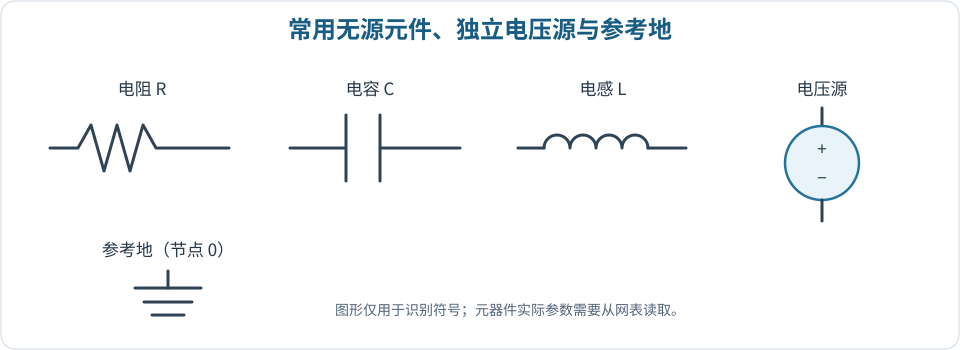

对应 [MOS 基础与电压定义](./content/chapters/02-mos-basics.md)。阅读电路图时应先识别参考地，再核对器件连接关系。

### NMOS 与 PMOS 四端节点

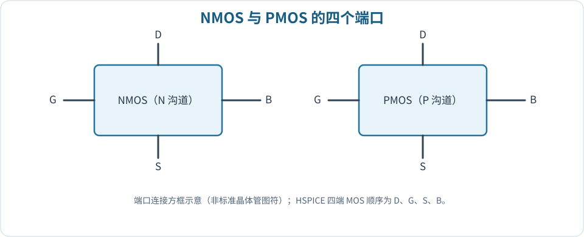

**教材对照：**图 2.1（印刷第 30 页）的 NMOS 无栅极反相圆圈，D 在上、S 在下；图 2.2（印刷第 31 页）的 PMOS 栅极有圆圈，S 在上、D 在下。两种器件均标出右侧体端 B。HSPICE 独立四端 MOS 实例按 D、G、S、B 排列；子电路接口顺序以 `.subckt` 定义为准。

### 电阻负载 NMOS 反相器（教材图 1.12）

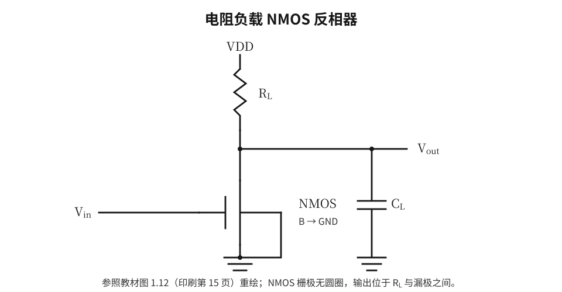

参照教材印刷第 15 页图 1.12：负载电阻 $R_L$ 位于 VDD 与输出节点之间，NMOS 漏极接 Vout、栅极接 Vin、源极与体端接 GND，负载电容 $C_L$ 从输出接地。该电路与上、下互补 MOS 组成的 CMOS 反相器不同。

### NMOS 输出特性族

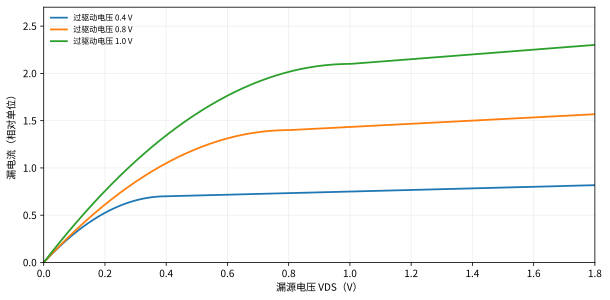

横轴为 $V_{DS}$、不同曲线对应不同 $V_{GS}$ 时是输出特性族。课程中还要求区分扫描 $V_{GS}$ 所得的转移特性。

### 电阻负载反相器的负载线

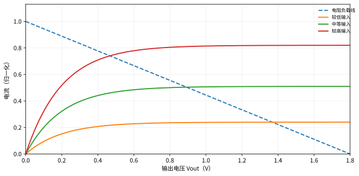

负载线与器件特性曲线交点决定直流工作点。参见 [反相器与噪声容限](./content/chapters/04-inverters-noise.md)。

## CMOS 反相器与逻辑门

### CMOS 反相器

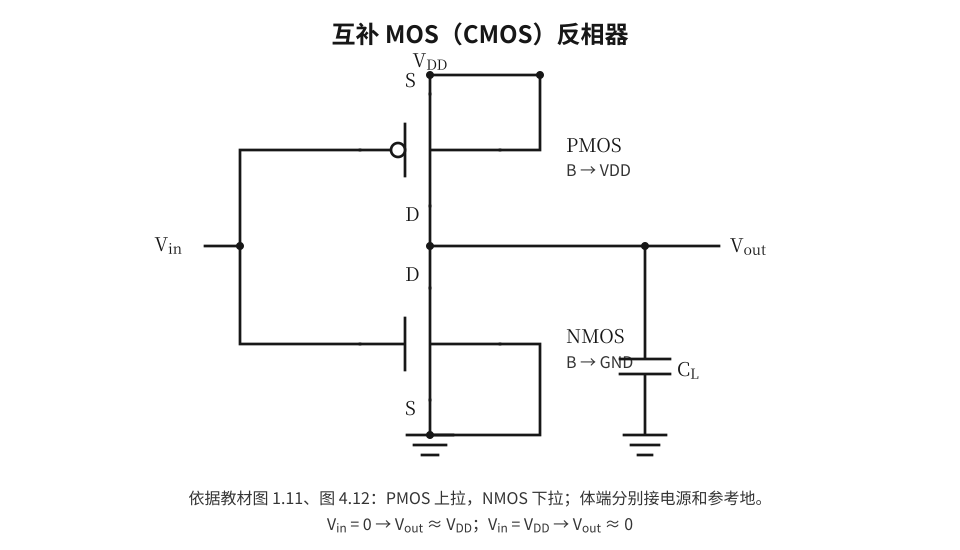

依据教材图 1.11（印刷第 14 页）和图 4.12（印刷第 128 页）重绘：上方 PMOS 的 S、B 接 VDD，下方 NMOS 的 S、B 接 GND；两管栅极共同接 Vin，两管漏极共同接 Vout，输出并联负载电容。PMOS 栅极反相圆圈不可省略。

### CMOS 电压传输曲线

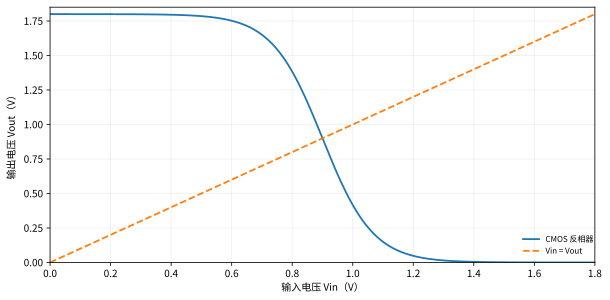

VTC 可用于识别输入高低电平、转换区以及噪声容限。

### 静态逻辑网络与功能门

**两输入 NOR2 / NAND2（教材图 5.1，印刷第 150 页）：**

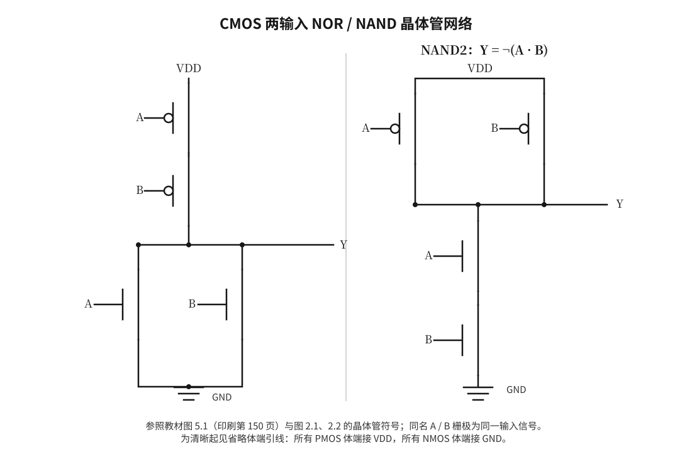

### 三输入 CMOS 网络

**NAND3 / NOR3（教材练习 5.1 扩展）：**

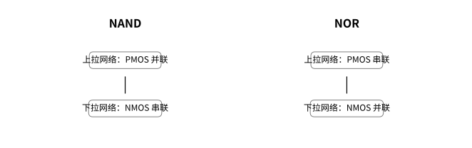

NAND 的 PMOS **并联**、NMOS **串联**；NOR 的 PMOS **串联**、NMOS **并联**，器件数量分别对应 2/3 个输入。每只器件绘有独立栅极，并由 A、B、C 标注相应控制输入，不再以文字矩形框代替实际电路。同名栅极标签代表共用输入网络；为了减少视觉杂乱，这两张逻辑网络图仅省略体端引线，PMOS 的 B 接 VDD、NMOS 的 B 接 GND。

### CMOS 门的晶体管尺寸（教材图 5.2）

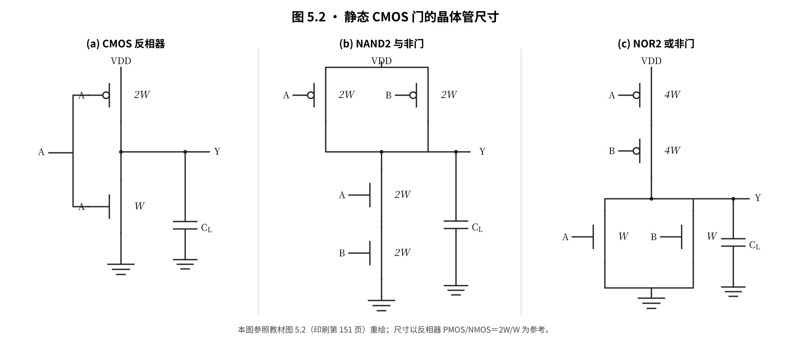

按教材印刷第 151 页图 5.2 重绘，以 **CMOS 反相器 PMOS=2W、NMOS=W** 作为归一化尺寸参考：NAND2 的两只并联 PMOS 各为 2W、两只串联 NMOS 各为 2W；NOR2 的两只串联 PMOS 各为 4W、两只并联 NMOS 各为 W。图中保留各晶体管与尺寸的对应关系、输入端、输出节点和接地负载电容 $C_L$。该比例用于教材中的一阶等效电阻设计，不是工艺模型下的唯一最佳尺寸。

### XOR 与 2:1 选择器

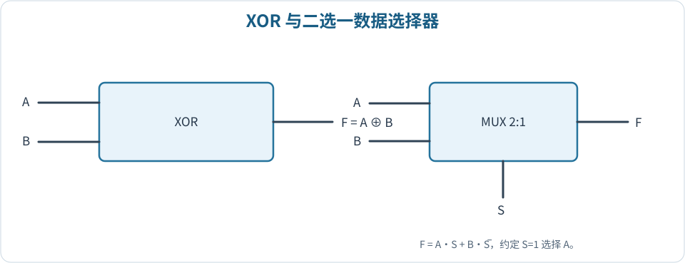

本文采用 $S=1$ 选 A、$S=0$ 选 B 的约定，故选择器函数为 $F=AS+B\overline{S}$。参见 [组合逻辑](./content/chapters/06-combinational-logic.md)。

## 时序逻辑与动态特性

### SR 锁存器

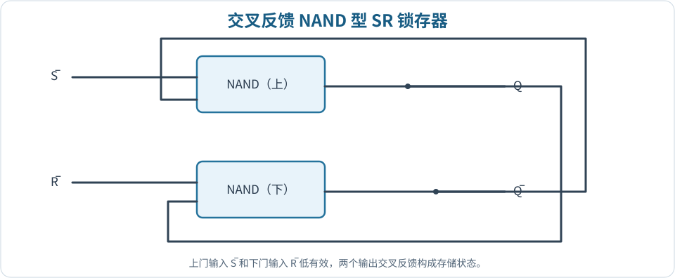

交叉反馈的两只 NAND 门组成低有效 SR 锁存器。判断时应分别检查输入有效电平和输出互补关系。

### 主从 JK 触发器

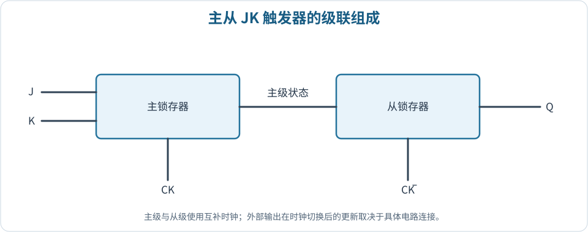

图示强调主、从级联和互补时钟，不包含内部所有门级反馈路径；外部触发沿必须结合实际结构判断。

### RC 延迟近似

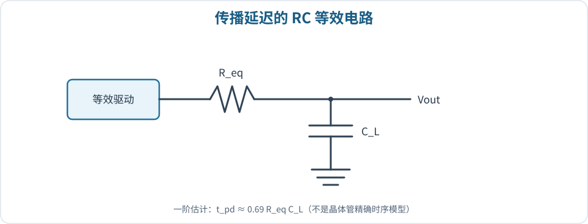

在一阶等效模型中，传播延迟随输出等效电阻及总负载电容增大而增长；真实 CMOS 延迟还需由器件模型验证。

---

**建议下一步：**先完成 [专题实践题](./content/practice/index.md)，再使用 [在线自测](./quiz.md)检查核心概念；需查看课程原始记录时可进入 [PDF 资料页](./pdf.md)。
