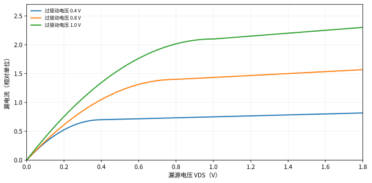

# 第2章 MOS晶体管

## 2.1 结构、符号、NMOS与PMOS

MOS晶体管主要包括**栅极G、漏极D、源极S、体端B**。栅与半导体间通过氧化层等绝缘材料隔开，栅电压调节沟道中载流子分布，进而控制漏源电流。教材图2.1—2.3介绍器件剖面和CMOS共同制造结构。

- **增强型NMOS：** $V_{GS}>V_{Tn}$（在长沟道简化判定中）形成强反型沟道；常把源置于较低电位。
- **增强型PMOS：** 采用 $V_{SG}$ 和 $V_{SD}$ 作为正向偏置量，导通判据 $V_{SG}>|V_{Tp}|$；体端通常接较高电位。
- **体端并不总等于源端：** 当 $V_{SB}\neq0$ 时，体效应会改变阈值。

**四端电压必须先统一参考方向。** 对NMOS采用 $V_{GS}=V_G-V_S$、$V_{DS}=V_D-V_S$、$V_{SB}=V_S-V_B$。对PMOS用 $V_{SG}=V_S-V_G$、$V_{SD}=V_S-V_D$、$V_{BS}=V_B-V_S$ 的具体符号时应格外核对，通常直接以正的 $|V_{Tp}|$ 表示阈值大小。

## 2.2 氧化层电容、表面势和阈值电压

单位面积氧化层电容：

$$C_{ox}=\frac{\varepsilon_{ox}}{t_{ox}}.$$

氧化层越薄，$C_{ox}$ 越大；给定电压变化时可诱导更多沟道电荷，也会影响栅电容、驱动能力及隧穿泄漏等。

原书从费米势、耗尽区电荷推导出阈值电压，其中体效应简化为：

$$\boxed{V_{Tn}=V_{Tn0}+\gamma\left[\sqrt{2\phi_F+V_{SB}}-\sqrt{2\phi_F}\right]}$$

$$\gamma=\frac{\sqrt{2q\varepsilon_{si}N_A}}{C_{ox}}.$$

$V_{Tn0}$ 是 $V_{SB}=0$ 时的阈值，$\gamma$ 是体效应系数，$\phi_F$ 是费米势的幅值。这里讨论的是通常的NMOS反向体偏置 $V_{SB}\geq0$。**正向增大 $V_{SB}$ 通常使NMOS $V_T$ 增大**，在源极随电压上升的传输器件中尤其重要。

**例题2-A：** $V_{Tn0}=0.40\,V$、$\gamma=0.45\,V^{1/2}$、$2\phi_F=0.70\,V$、$V_{SB}=0.50\,V$。

$$V_T=0.40+0.45(\sqrt{1.20}-\sqrt{0.70})\approx0.516\,V.$$

相比 $V_{SB}=0$，阈值增加约0.116V。

## 2.3 长沟道模型：先工作区，后电流

定义过驱动电压 $V_{OV}=V_{GS}-V_T$，令

$$k_n'=\mu_n C_{ox},\qquad \beta_n=k_n'\frac WL.$$

**NMOS截止区：** $V_{GS}\leq V_T$，理想强反型模型 $I_D\approx0$。真实器件仍可能存在亚阈值电流。

**NMOS线性（三极管）区：** $V_{GS}>V_T$ 且 $0\leq V_{DS}<V_{OV}$，

$$\boxed{I_D=\beta_n\left[(V_{GS}-V_T)V_{DS}-\frac{V_{DS}^2}{2}\right]}.$$

当 $V_{DS}\ll V_{OV}$，近似 $I_D\approx\beta_nV_{OV}V_{DS}$，等效导通电阻约 $1/(\beta_nV_{OV})$。

**NMOS饱和区：** $V_{GS}>V_T$ 且 $V_{DS}\geq V_{OV}$，长沟道平方律为

$$\boxed{I_{D,sat}=\frac{\beta_n}{2}(V_{GS}-V_T)^2}.$$

考虑沟道长度调制时，可引入经验修正 $(1+\lambda V_{DS})$；本讲义的未注明计算题默认忽略它。**饱和不是“电流永不变化”或“晶体管关断”，而是沟道漏端夹断后的工作区。**

PMOS可用 $V_{SG}$、$V_{SD}$、$|V_{Tp}|$ 与 $\beta_p=\mu_pC_{ox}W_p/L_p$ 改写上述方程，电流按源到漏的正幅值计算。

**例题2-B：** $k'_n=200\,\mu A/V^2$，$W/L=5$，$V_T=0.4\,V$，$V_{GS}=1.2\,V$。有 $\beta=1000\,\mu A/V^2$，$V_{OV}=0.8\,V$。

- 当 $V_{DS}=0.2\,V$，位于线性区：$I_D=1000(0.8\times0.2-0.2^2/2)=140\,\mu A$。
- 当 $V_{DS}=1.0\,V$，位于饱和区：$I_D=1000\times0.8^2/2=320\,\mu A$。

## 2.4 电流公式的物理意义

沟道中的反型电荷密度在渐变沟道近似下可写成

$$Q_i(y)\approx-C_{ox}[V_{GS}-V_T-V(y)].$$

漂移电流大小 $I_D=W|Q_i|v$，低场下 $v=\mu_n E$，$E=dV/dy$。把沟道从源端0积分至漏端 $V_{DS}$，便得到上一节的线性区电流式。$V_{DS}=V_{OV}$ 时出现长沟道模型中的饱和分界。

这条推导说明：$I_D$ 不仅随 $W/L$ 变化，还取决于沟道反型电荷和电场分布；而且每个模型均有适用条件。

## 2.5 速度饱和与短沟道效应

当横向电场增加，载流子速度不再无限遵循 $v=\mu E$。教材给出平滑近似：

$$v\approx\frac{\mu E}{1+E/E_c}.$$

$E_c$ 为临界电场。当 $E\gg E_c$ 时，速度趋近饱和值 $v_{sat}\approx\mu E_c$；短沟道器件的电流对栅过驱动的依赖会偏离平方律。原书第2.5节还给出短沟道的饱和电压修正，可表示成：

$$V_{Dsat}\approx\frac{V_{OV} E_cL}{V_{OV}+E_cL}.$$

如果 $E_cL\gg V_{OV}$，接近长沟道 $V_{Dsat}\approx V_{OV}$；如果器件长度很短，饱和可以提前出现。因此**不能把教材长沟道的 $V_{DS}=V_{GS}-V_T$ 边界不加检验地应用到所有先进器件**。

原书第2.6节讨论经验 $\alpha$ 次方定律（$\alpha$ 根据工艺与偏置条件确定）：

$$I_{D,sat}\approx K_\alpha\frac WL(V_{GS}-V_T)^\alpha.$$

$\alpha=2$ 接近平方律；对于明显速度饱和的情形，$\alpha$ 可能向1靠近。其经验参数**不能与**平方律里的 $k'_n$ 直接混用。

## 2.6 亚阈值导电

截止区的电流不是严格零。原书2.7节用指数关系描述弱反型：

$$I_{sub}\propto\exp\!\left(\frac{V_{GS}-V_T}{nU_T}\right),\qquad U_T=\frac{kT}{q}.$$

亚阈值摆幅 $S$ 定义为漏电流变化**10倍**所需的栅电压变化：

$$\boxed{S=\frac{dV_{GS}}{d\log_{10} I_D}=nU_T\ln10}.$$

在约300K下，理想极限接近60mV/dec，真实器件通常更大。若 $S=90\,mV/dec$，$V_{GS}$ 增加180mV，则按此局部指数模型，电流约增大 $10^{180/90}=100$ 倍。

## 2.7 MOS晶体管电容

教材第2.8节将寄生电容分为三类：

1. **栅氧化层相关的本征电容：** 粗略量级 $C_{ox}WL$，随偏置在栅—体、栅—源、栅—漏之间重新分配。
2. **栅重叠电容：** 栅与源漏扩散区之间存在工艺造成的重叠；数量级随栅宽 $W$ 增长。
3. **源漏PN结电容：** 结底面积和侧墙周长均有贡献，而且与反向偏压相关。

在理想长沟道强反型近似中：饱和区常以 $C_{gs}\approx\tfrac23C_{ox}WL$、$C_{gd}\approx0$ 表示本征部分；线性区常近似平分，$C_{gs}\approx C_{gd}\approx\tfrac12C_{ox}WL$。这些是**本征近似**，实际还要加重叠等寄生项。

单位面积突变结电容的一个常用模型：

$$C_j(V_R)=\frac{C_{j0}}{\big(1+V_R/\phi_0\big)^m},$$

其中 $V_R\geq0$ 为反向偏压。实际总结电容还要考虑侧墙：$C_{junction}\approx C_{j}A+C_{jsw}P$（相应系数需按工艺及偏压取值）。

**例题2-C：** $C_{ox}=8\,fF/\mu m^2$，$W=2\,\mu m$，$L=0.2\,\mu m$。则栅氧化层面积电容尺度 $C_{ox}WL=3.2\,fF$。如果在饱和区估算本征 $C_{gs}$，约为 $2.13\,fF$，但不能漏掉重叠电容。

## 2.8 尺寸与工作区的典型易错点

- **改变 $W$：** 在长沟道、固定其他参数下，驱动电流和本征栅电容通常随 $W$ 成比例增加。
- **改变 $L$：** 长沟道模型里驱动系数随 $1/L$ 增加；实际短沟道的 $V_T$、迁移率和饱和机制也会随尺寸变化。
- **源极漂移：** 在传输高电平时，随着源极电压提高，$V_{GS}$ 变小、$V_{SB}$ 可能变大，导通条件逐渐丧失。
- **不能只看 $V_G$ 判导通：** 必须看 $V_G-V_S$（NMOS）或 $V_S-V_G$（PMOS）。

---

[本章练习](/review-1to4/02-exercises) · [答案解析](/review-1to4/02-answers) · [目录](/review-1to4/)
