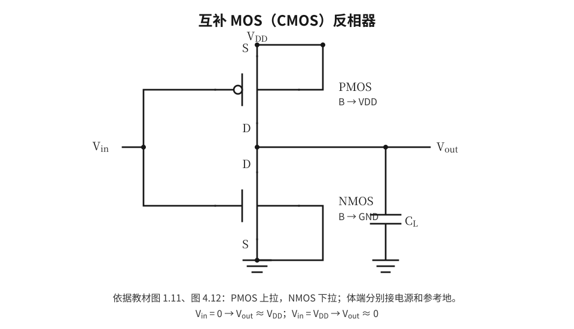
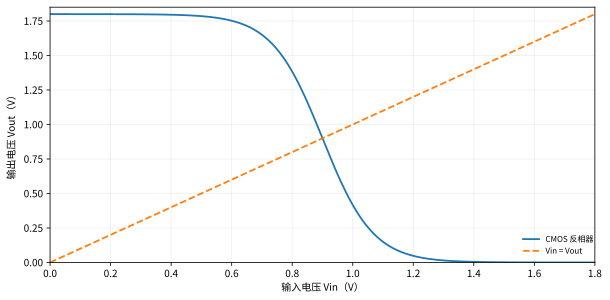

# 第4章 MOS反相器电路

## 4.1 为什么反相器是基础单元

原书第4章对**静态VTC**、**噪声容限**、**不同负载结构**及**反相器尺寸**进行系统分析。反相器同时检验直流工作点、电流驱动、动态充放电和噪声容限，因此是把第2、3章知识连接起来的最典型电路。

反相器满足逻辑 $Y=\overline X$。良好的反相器希望有：接近电源轨的 $V_{OH}$/$V_{OL}$、陡峭的VTC、较大的噪声容限、较低的传播延迟与可控静态功耗。

## 4.2 电压传输特性与静态工作点

求任何反相器的直流VTC，基本方程都是输出节点的KCL：

$$I_{pullup}(V_{in},V_{out})=I_{pulldown}(V_{in},V_{out}).$$

然后按照假定工作区代入相应器件方程，并验证求出的结果确实符合其工作区约束。原书4.2节介绍输出高低电平、切换点、增益和转移特性；4.3节进一步定义噪声容限。

**两个容易混淆的“负号”：** 反相器的静态小信号增益 $A_v=dV_{out}/dV_{in}$ 为负；用噪声边界时找的是斜率等于 $-1$ 的点，不是 $|A_v|$ 最大的点。

## 4.3 单端噪声容限SSNM、多端噪声容限MSNM

教材4.3将单端与多端噪声容限分别讨论。**SSNM**采用一个噪声扰动作用于某一级链路的假设，借助VTC曲线上的电压边界量确定可容许的噪声幅值，常以第1章的 $NM_L/NM_H$ 为计算基础。

**MSNM**考虑多个级联节点各自带有噪声扰动，要求分析噪声在电压转移特性中的传递与累积，而不仅只给出一级反相器的单个差值。复杂噪声容限问题可使用级联VTC进行图解或数值求解。

复习时掌握：曲线增益（斜率）决定扰动是放大还是衰减；静态噪声容限和动态瞬态噪声免疫能力不能完全等同。

## 4.4 电阻负载NMOS反相器

电路由上拉电阻 $R_L$ 与下拉NMOS构成，输出点位于两者之间。输入低电平时NMOS截止，近似 $V_{OH}=V_{DD}$；输入高电平时NMOS导通，输出低电平由电阻电流与晶体管电流相等决定。

$$\boxed{\frac{V_{DD}-V_{out}}{R_L}=I_{Dn}(V_{in},V_{out}).}$$

当 $V_{in}=V_{DD}$ 且求出的 $V_{out}<V_{DD}-V_{Tn}$ 时，下拉NMOS在线性区：

$$\frac{V_{DD}-V_{OL}}{R_L}=\beta_n\left[(V_{DD}-V_T)V_{OL}-\frac{V_{OL}^2}{2}\right].$$

可用二次方程求 $V_{OL}$，舍去不符合物理范围或工作区的根。

**例题4-A：** $V_{DD}=1.2\,V$、$V_T=0.4\,V$、$\beta_n=0.5\,mA/V^2$、$R_L=20\,k\Omega$。在 $V_{in}=1.2\,V$ 时

$$\frac{1.2-V_{OL}}{20000}=0.0005\left(0.8V_{OL}-0.5V_{OL}^2\right),$$

整理为 $5V_{OL}^2-9V_{OL}+1.2=0$，物理解为

$$V_{OL}=\frac{9-\sqrt{57}}{10}\approx0.145\,V.$$

小于过驱动0.8V，线性区假设成立。对应静态电流 $I\approx(1.2-0.145)/20k\Omega=52.7\,\mu A$，静态功耗约 $63.3\,\mu W$。

**重要代价：** 电阻负载反相器在输出低时存在由 $V_{DD}$ 到GND的静态通路；选择更小 $R_L$ 虽然加强上拉，但可能增大低电平静态功耗并改变 $V_{OL}$。

## 4.5 用NMOS晶体管代替上拉电阻

原书4.5节比较不同NMOS负载结构，包括增强型负载及具有不同栅偏置/耗尽型特性的负载。这里重点看**输出高电平是否退化**、**有无持续静态电流**与**上下拉强弱之比**。

对于**栅极直接接 $V_{DD}$ 的增强型NMOS上拉器件**，当输出上升时其 $V_{GS}=V_{DD}-V_{out}$ 减小，直至接近阈值，可能得到近似

$$V_{OH}\lesssim V_{DD}-V_{Tn,load}.$$

源体偏置造成的体效应会进一步影响最终电平。这个公式是教学近似，不能代替完整偏置和瞬态收敛计算。

当上拉与下拉同时导通，输出电平通过KCL确定，宽长比影响驱动能力。教材用**负载比 $K_R$** 等指标比较器件尺寸与导通特性。由于NMOS上拉通常不能同时保证完整电源轨摆幅与零静态功耗，所以CMOS互补结构更有优势。

## 4.6 CMOS反相器的五个工作区

互补型CMOS由PMOS上拉、NMOS下拉构成。理想静态端点：

$$V_{in}=0:\;V_{out}\approx V_{DD},\qquad V_{in}=V_{DD}:\;V_{out}\approx0.$$

在中间输入电压，两个器件可能同时导通。VTC常按从低输入到高输入分成五个工作区域（以长沟道模型直观描述）：

| 区域 | NMOS | PMOS | 曲线特征 |
|:--|:--|:--|:--|
| I | 截止 | 线性（近输出高轨） | 输出高 |
| II | 饱和 | 线性 | 输出开始下降 |
| III | 饱和 | 饱和 | 切换附近、增益大 |
| IV | 线性 | 饱和 | 输出趋近低轨 |
| V | 线性（近输出低轨） | 截止 | 输出低 |

以上是一种典型的长沟道工作区划分。器件的精确转换点随阈值、尺寸、短沟道效应和偏压而变。

## 4.7 CMOS开关电压及其尺寸比

长沟道且两管均处于饱和区、忽略沟道长度调制时，切换点 $V_M$ 满足：

$$\frac{\beta_n}{2}(V_M-V_{Tn})^2=\frac{\beta_p}{2}(V_{DD}-V_M-|V_{Tp}|)^2.$$

设 $r=\sqrt{\beta_p/\beta_n}$，求得

$$\boxed{V_M=\frac{V_{Tn}+r(V_{DD}-|V_{Tp}|)}{1+r}}.$$

若 $V_{Tn}=|V_{Tp}|$ 且 $\beta_n=\beta_p$，则 $V_M=V_{DD}/2$。**平衡的驱动能力并不意味着 $W_n=W_p$**；由于通常电子迁移率高于空穴迁移率，PMOS往往需更宽才能平衡电流。

令 $\beta_n=k'_nW_n/L_n$、$\beta_p=k'_pW_p/L_p$，若两个沟道长度相同，想实现 $\beta_n=\beta_p$，则

$$\frac{W_p}{W_n}=\frac{k'_n}{k'_p}=\frac{\mu_n}{\mu_p}\quad(\text{假定两者}C_{ox}\text{相同}).$$

**例题4-B：** $V_{DD}=1.2\,V$、$V_{Tn}=|V_{Tp}|=0.4\,V$、$k'_n=240\,\mu A/V^2$、$k'_p=80\,\mu A/V^2$，$L_n=L_p$，$W_n=0.4\,\mu m$。平衡 $\beta$ 要求 $W_p=1.2\,\mu m$；此时近似 $V_M=0.6\,V$。

如果 $W_p=W_n$，则 $r=\sqrt{1/3}$，因此 $V_M\approx(0.4+0.577\times0.8)/(1+0.577)\approx0.546\,V$，向较强NMOS一侧偏移的表现是切换点低于半电源电压。

## 4.8 反相器尺寸设计：电平、速度与面积的折中

**设计步骤：**

1. 根据工作电源和噪声需求确定目标 $V_M$、$NM_H$、$NM_L$。
2. 利用 $\beta_n/\beta_p$ 的目标值确定 $W_p/W_n$；如果 $L_n=L_p$，可以先按迁移率/模型驱动系数比估算。
3. 以目标负载电容 $C_L$ 和延迟估算需要的绝对宽度：$R_{eq}\propto1/W$，所以增大宽度通常可降低本级导通电阻。
4. 再计算增加宽度后引入的**输入栅电容**，评估前一级的额外负担。
5. 用SPICE对实际工艺模型进行VTC、$t_{pHL}$、$t_{pLH}$及PVT扫描，最后结合版图寄生优化。

**易错重点：** 放大一整级反相器并不必然减小整个链路总延迟，因为它也让上一级承担更大负载；必须对整个路径优化。

## 4.9 CMOS传播延迟与静态功率

动态切换时：输入上升→NMOS导通→输出电容经下拉网络放电，主要对应 $t_{pHL}$；输入下降→PMOS导通→输出经上拉网络充电，主要对应 $t_{pLH}$。

$$t_{pHL}\approx0.69R_nC_L,\qquad t_{pLH}\approx0.69R_pC_L.$$

**例题4-C：** $R_n=8\,k\Omega$，$R_p=12\,k\Omega$，$C_L=20\,fF$。则

$$t_{pHL}\approx110.4\,ps,\quad t_{pLH}\approx165.6\,ps,\quad t_p\approx138\,ps.$$

理想CMOS在稳定的0/1输入下只有一只管导通，另一个关断，因此不存在像电阻负载NMOS反相器那样的持续大电流上拉—下拉通路。真实CMOS仍有漏电；在切换瞬间还可能短暂发生上下拉同时导通的短路电流。

## 4.10 伪NMOS、三态与版图关联

原书第4.7—4.9节分别讨论伪NMOS反相器、反相器尺寸、三态反相器。

- **伪NMOS：** PMOS上拉栅极常接低电位使其持续导通，下拉NMOS受输入控制；门的晶体管数与某些结构可能有优势，但输出低时存在静态功耗和比例约束。
- **三态反相器：** 除逻辑0/1，增加高阻态 $Z$。使能有效时 $Y=\overline A$；使能无效时输出不主动驱动高或低。
- **CMOS版图：** 需要布局NMOS/PMOS、有源区、栅、接触、金属与阱连接；适当共享扩散区可以减少面积及寄生，但要遵守设计规则。

三态门的 $Z$ 是输出**高阻**，不能当作“第三种稳定电压”或等同于逻辑0。若总线上没有任何驱动器，电压可能由寄生电容或其他器件决定。

## 4.11 完整解题模板：从假设到检验

例如题目要求求某NMOS负载反相器在 $V_{in}=1.2\,V$ 时的输出：

**步骤一：** 画出输出节点，标注 $V_{GS},V_{DS},V_{SB}$，明确谁是上拉、谁是下拉。

**步骤二：** 先写 $I_{up}=I_{down}$，不要先盲套饱和公式。

**步骤三：** 判断/假定两个器件各自工作区，代入长沟道模型或题设给定的速度饱和模型。

**步骤四：** 解出 $V_{out}$、电流及需要的功耗。

**步骤五：** 核查 $0\leq V_{out}\leq V_{DD}$、每只管的工作区条件、根的物理性。如果不满足假设，换区重算。

**步骤六：** 有真实工艺模型时，再用HSPICE直流VTC验证。

## 4.12 本章检查点

1. 能区分电阻负载、增强型NMOS负载、伪NMOS和CMOS反相器。
2. 能独立写出输出节点KCL，并正确处理NMOS线性与饱和两种方程。
3. 能解释SSNM/MSNM与 $V_{IL},V_{IH}$ 的关系。
4. 能从 $\beta_n/\beta_p$ 反推 $W_p/W_n$，并解释尺寸对延迟和输入负载的双重影响。
5. 会从VTC求开关点，并从瞬态波形识别上升/下降传播延迟。

**本章专用拓展：** [交互训练20题](/review-1to4/interactive-04) · [进阶题与解析](/review-1to4/advanced-04-exercises) · [教材原例题索引](/review-1to4/textbook-examples) · [计算方法专项](/review-1to4/calculation-methods) · [在线实验](/review-1to4/online-lab)

---

[本章练习](/review-1to4/04-exercises) · [答案解析](/review-1to4/04-answers) · [目录](/review-1to4/)
